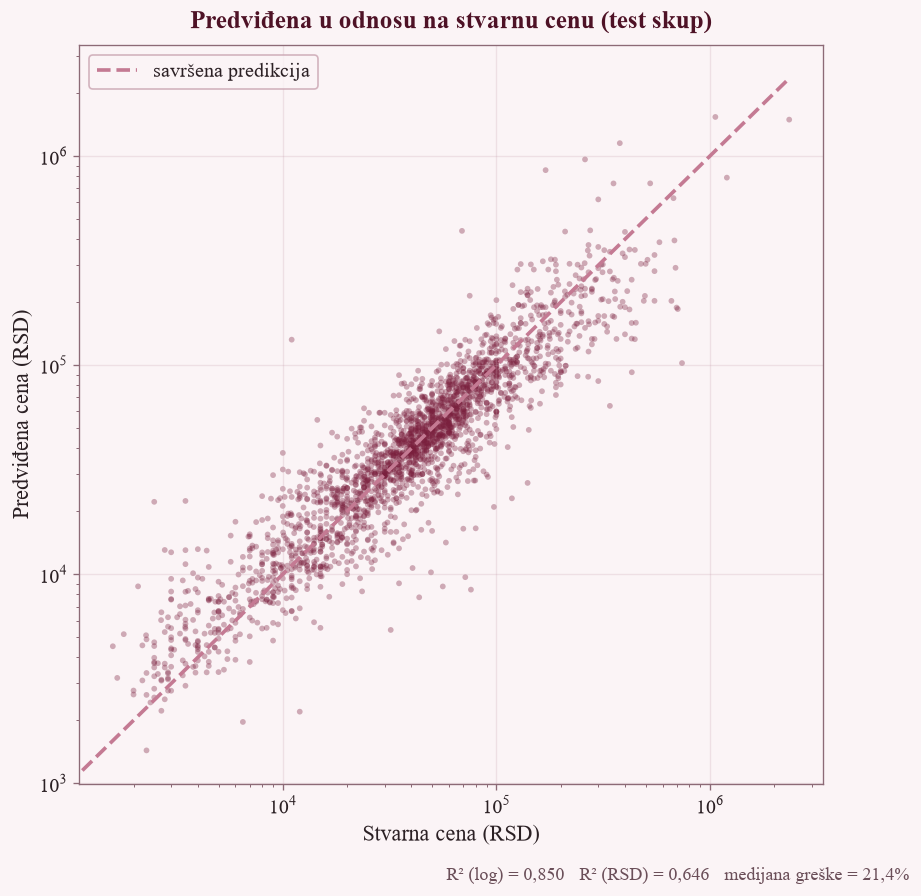
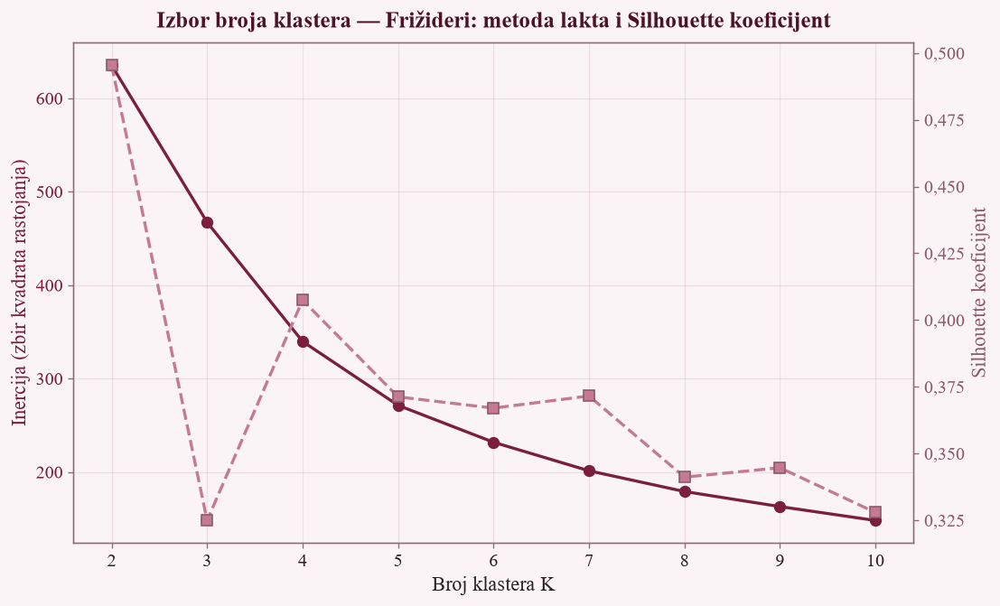
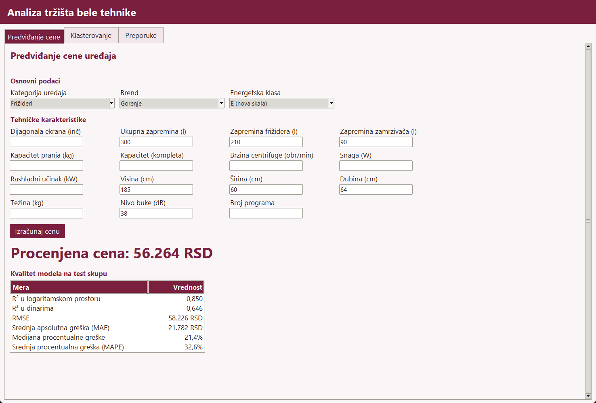
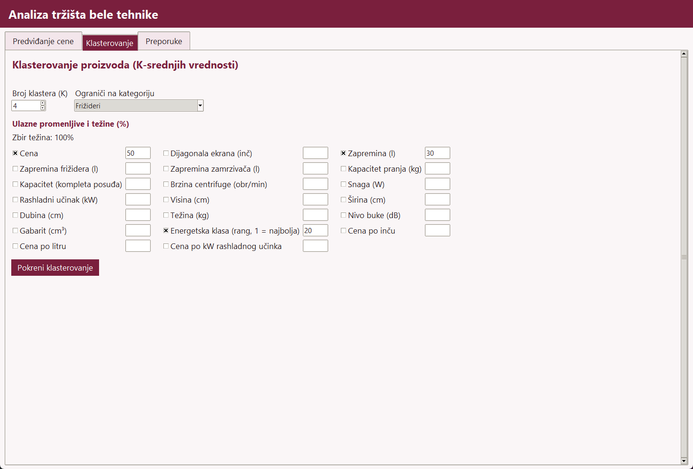
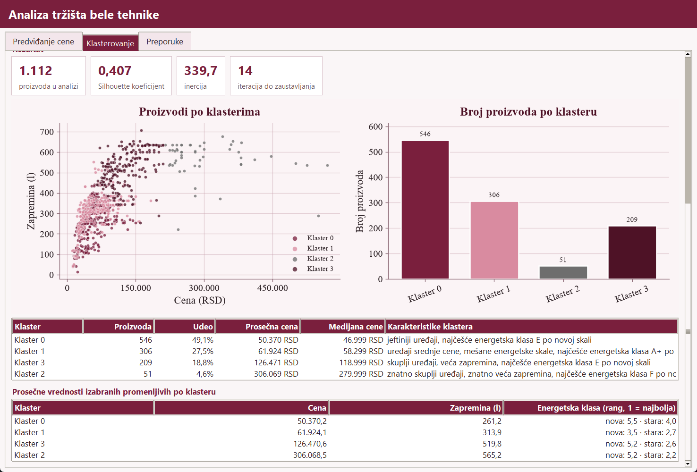
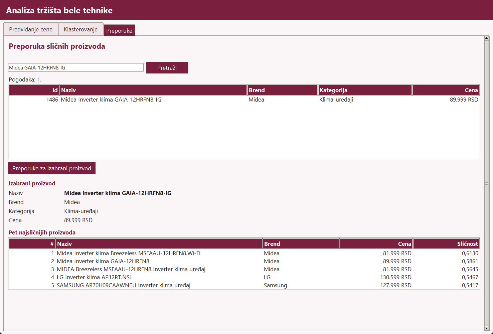
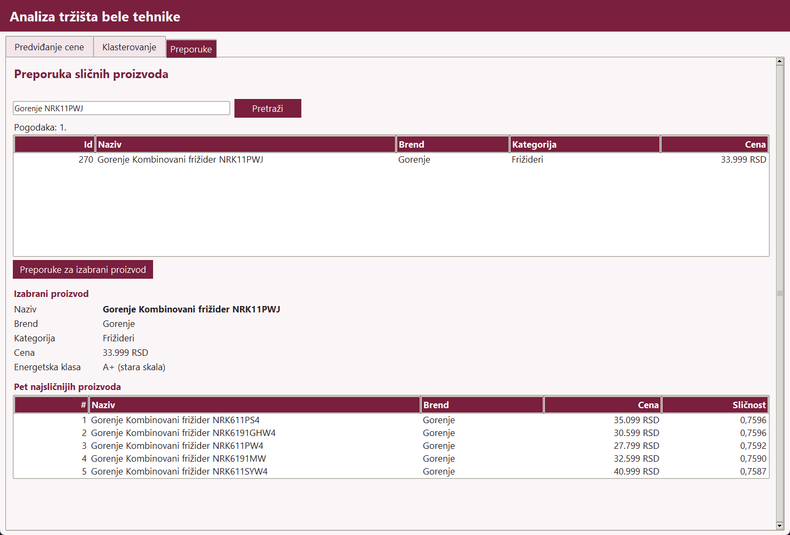

# Home appliance market analysis: data mining on two Serbian web shops

**Course project** — University of Belgrade, School of Electrical Engineering, course *Pronalaženje skrivenog znanja* (Knowledge Discovery / Data Mining), academic year 2025/26

Author: Anđela Spasić

*Serbian version of this document: [README.sr.md](README.sr.md)*

Product data on home appliances (large and small household appliances, air conditioners and televisions) was collected from two Serbian web shops, gigatron.rs and winwin.rs, cleaned into a second database, analysed with SQL queries and charts, and used to build three models written without machine-learning libraries: multiple linear regression trained by gradient descent (price prediction), K-means with k-means++ initialisation and user-chosen feature weights, and a content-based recommender (TF-IDF, one-hot brand and standardized numeric features, compared by cosine similarity). A tkinter desktop window exposes all three models. scikit-learn appears in one file only, to check the hand-written implementations.

Code identifiers, comments, chart labels and the report are in Serbian.

## What it does

1. **Crawl** — reads product URLs from the shops' sitemaps and saves every product page to disk (gzip), respecting robots.txt and pausing between requests.
2. **Parse** — two parsers, one per shop platform, turn the saved pages into rows of a primary PostgreSQL database; attributes are stored as name–value pairs exactly as written on the site.
3. **Clean** — maps categories and brands to controlled vocabularies, extracts numbers and units from text, separates the two energy-label scales, merges the same device from both shops into one row, and writes the result to a second, cleaned database.
4. **Query** — seven SQL statements over the cleaned database, answering five questions, exported to Excel.
5. **Visualize** — bar charts of categories, brands, price bands and energy classes, each bar labelled with count and percentage.
6. **Model** — price regression, clustering and recommendations, each implemented by hand.
7. **Use** — a desktop application with three tabs: price prediction, clustering, recommendations.

In the code, file headers and the report these stages are referred to by the task numbers of the course assignment: *Zadatak 1* (data collection), *Zadatak 2* (cleaning and SQL analysis), *Zadatak 3* (visualization), *Zadatak 4* (regression), *Zadatak 5* (clustering) and *Zadatak 6* (recommender).

## Results

| Stage | Result |
|---|---|
| Pages downloaded | 53,482 of 53,551 requests (69 failed, all HTTP 404) |
| Products in the primary database | 15,949 (winwin.rs 9,634, gigatron.rs 6,315), with 300,688 attribute records |
| Products after cleaning and merging | 11,984 (75.1%) |
| Device categories | 38 |
| Manufacturers | 197 (reduced from 260 brand spellings among the retained products) |
| Devices found in both shops | 1,244 (a lower bound) |
| Price regression, test set (2,397 products) | R² 0.850 in log space, 0.646 in RSD; RMSE 58,226 RSD; MAE 21,782 RSD; median error 21.4%; MAPE 32.6% |
| K-means example | 1,112 fridges, K = 4, weights price 50% / volume 30% / energy class 20%: Silhouette 0.407, inertia 339.7, converged in 14 iterations |
| Recommender examples | Midea air conditioner: similarities 0.6130 to 0.5417; Gorenje fridge: 0.7596 to 0.7587 |

Answers to the five questions, from the cleaned data (full results are in `izvestaj/rezultati_upita.xlsx`):

| Question | Answer |
|---|---|
| Products per category | 38 categories; largest are televisions (1,895), fridges (1,464), washing machines (856), vacuum cleaners (821) |
| Ten most common brands | Gorenje (1,384), Bosch (1,215), Beko (1,148), VOX (989), LG (844), Samsung (622), Philips (468), Candy (416), Miele (287), Hisense (273); together 7,646 products (63.8%) |
| Energy class C (or A+ on the old scale) or better | 2,518 of 7,343 products with a known class and scale (34.3%) |
| Price up to 50,000 RSD | 7,061 products (58.9%) |
| 30 most expensive televisions | the most expensive is Samsung QE98QN100BTXXH at 3,779,999 RSD |

Price bands: 35.6% of products cost up to 30,000 RSD, 49.2% between 30,001 and 100,000, 12.9% more than 100,000 but less than 300,000, and 2.3% cost 300,000 or more. Televisions and fridges together make up 28.0% of the cleaned database. 4,641 products (38.7%) state no energy class.

## The three models

All three read the cleaned database. numpy and pandas are used for arrays and tables, matplotlib for charts; no library is used for training.

### Multiple linear regression (price prediction)

Written by hand: the cost function, its gradient, the gradient-descent loop, prediction, one-hot encoding, standardization, the train/test split and all quality metrics.

```
ŷ = θ₀ + θ₁x₁ + θ₂x₂ + … + θₙxₙ
J(θ) = (1/2m) · Σ(ŷ − y)²  +  (λ/2m) · Σθⱼ²        (j ≥ 1)
∂J/∂θ = (1/m) · Xᵀ(Xθ − y)  +  (λ/m) · θ'          (θ'₀ = 0)
θ := θ − α · ∂J/∂θ
```

```
R² = 1 − Σ(y − ŷ)² / Σ(y − ȳ)²
RMSE = √( mean((y − ŷ)²) )
MAE = mean(|y − ŷ|)
MAPE = mean(|y − ŷ| / y) · 100
median APE = median(|y − ŷ| / y) · 100
```

Features: category, brand and energy-label scale as one-hot columns (brands with fewer than 15 products are grouped as "other"), the energy rank, and the numeric technical attributes. With the missing-value indicators and interaction terms described below, the final feature matrix has 785 columns: 17 numeric columns, 17 indicators, 105 one-hot columns and 646 interaction terms.

Design decisions:

- **Log-price target.** Prices range from 699 to 3,779,999 RSD, so on raw prices the most expensive devices dominate the squared error. The model learns log(price) and the prediction is returned as exp(Xθ). Under the same settings MAPE drops from 74.8% to 35.7%, and predictions are always positive; without the logarithm 159 of the 2,397 test devices received a price of zero or less.
- **Interaction terms.** Each numeric attribute is multiplied by the category indicator, so the model learns a separate slope per category: a litre of volume is not worth the same in a fridge and in a kettle. The column is standardized first and multiplied second; standardizing the multiplied column, which is almost all zeros, would give huge values and gradient descent would diverge. Without interactions R² (log) is 0.797 and the median error 25.9%, with them 0.826 and 23.5%.
- **Median imputation.** An empty field gets the median of its category (or of all products if the category has no value for that attribute), together with an indicator column marking that the value was missing. The median is not pulled by a few expensive devices.
- **Standardization.** z = (x − mean) / std, because volume is in hundreds of litres and energy rank runs from 1 to 8. Everything is fitted on the training set only.

Split 80:20 with seed 2026: 9,587 training and 2,397 test products. Experiments (metrics on the test set):

| α | Iterations | λ | log(price) | Interactions | R² (log) | Median error | MAPE | RMSE (RSD) |
|---|---|---|---|---|---|---|---|---|
| 0.001 | 3,000 | 0 | yes | yes | 0.5193 | 42.7% | 70.9% | 101,225 |
| 0.01 | 3,000 | 0 | yes | yes | 0.7266 | 31.2% | 47.5% | 69,946 |
| 0.1 | 3,000 | 0 | yes | yes | 0.8264 | 23.5% | 35.7% | 58,142 |
| 0.3 | 3,000 | 0 | yes | yes | diverged after 449 iterations | – | – | – |
| 0.1 | 10,000 | 0 | yes | yes | 0.8437 | 22.0% | 33.4% | 59,551 |
| 0.1 | 3,000 | 1 | yes | yes | 0.8260 | 23.5% | 35.8% | 58,039 |
| 0.1 | 3,000 | 10 | yes | yes | 0.8228 | 23.9% | 36.1% | 57,373 |
| 0.1 | 3,000 | 0 | no | yes | undefined | 38.2% | 74.8% | 60,100 |
| 0.1 | 3,000 | 0 | yes | no | 0.7966 | 25.9% | 39.2% | 63,676 |

L2 regularization does not help: gradient descent that starts from zero and runs a limited number of iterations already acts as a mild regularizer. Since R² (log) keeps rising with the number of iterations, the final model uses α = 0.1, λ = 0 and 25,000 iterations:

| Metric | Training set | Test set |
|---|---|---|
| R² (log space) | 0.8615 | 0.8502 |
| R² (RSD) | 0.6290 | 0.6462 |
| RMSE | 63,063 RSD | 58,226 RSD |
| MAE | – | 21,782 RSD |
| MAPE | – | 32.6% |
| Median percentage error | – | 21.4% |

Training and test metrics are close, so the model is not overfitted. R² in RSD is lower because the model minimizes relative error, and the same relative error on an expensive television is a very large squared error in dinars. RMSE is 2.7 times MAE for the same reason: the ten largest misses make up 47% of the sum of squares.



*Predicted versus actual price on the test set. The axes are logarithmic, so equal distance from the diagonal means equal relative error.*

### K-means clustering

Written by hand: k-means++ initialisation, assignment and centre update, inertia, the Silhouette coefficient, and a short generated description of each cluster.

The user picks the features, a weight for each, and K. Products missing any chosen value are left out. Columns are standardized, weights are normalized to sum to 1 (50 and 30 mean the same as 62.5 and 37.5), and each column is multiplied by the square root of its weight, so that in the squared Euclidean distance the weight acts exactly as the chosen share:

```
d² = Σ wⱼ · (xⱼ − cⱼ)²  =  Σ (√wⱼ·xⱼ − √wⱼ·cⱼ)²
inertia = Σ ‖xᵢ − c(i)‖²
s = (b − a) / max(a, b)
```

In the Silhouette formula *a* is the mean distance from a point to its own cluster and *b* the smallest mean distance to another cluster. It is computed on a sample of 2,000 points only when there are more points than that.

- **k-means++.** The first centre is random; each next one is drawn with probability proportional to the squared distance to the nearest centre already chosen.
- **Ten restarts.** The algorithm runs ten times with seeds 2026 to 2035 and keeps the solution with the lowest inertia, because k-means++ can still end in a worse local minimum: for K = 4 the first run gives inertia 364.85 and the best one 339.72.
- **Stopping.** A run stops when the assignment of points to clusters no longer changes (or after 300 iterations).

Example: fridges, with weights price 50%, volume 30%, energy class 20% (best of ten runs for each K):

| K | Inertia | Silhouette |
|---|---|---|
| 2 | 635.28 | 0.495 |
| 3 | 467.25 | 0.325 |
| 4 | 339.72 | 0.407 |
| 5 | 271.33 | 0.371 |
| 6 | 231.82 | 0.367 |
| 7 | 201.27 | 0.372 |
| 8 | 179.09 | 0.341 |
| 9 | 162.97 | 0.345 |
| 10 | 148.11 | 0.328 |



Inertia always falls, so it cannot choose K on its own. K = 2 has the highest Silhouette (0.495) but only separates large, expensive fridges from everything else. From K = 3 upwards the best value is K = 4 (0.407), which is used as the example. The curve has no sharp elbow, but the drop from 3 to 4 clusters is 127.5 and from 4 to 5 only 68.4.

| Cluster | Products | Share | Mean price | On the old label scale | Description |
|---|---|---|---|---|---|
| 0 | 546 | 49.1% | 50,370 RSD | 4 | cheaper devices, most often class E on the new scale |
| 1 | 306 | 27.5% | 61,924 RSD | 231 | mid-priced devices, mixed scales, most often A+ on the old scale |
| 3 | 209 | 18.8% | 126,471 RSD | 20 | more expensive, larger volume, most often E on the new scale |
| 2 | 51 | 4.6% | 306,069 RSD | 4 | much more expensive, much larger volume, most often F on the new scale |

A Silhouette of 0.407 indicates weak structure: the groups differ but overlap at the borders, because fridge price and volume grow gradually. The clustering also shows that clusters 0 and 1, which are close in price, are separated mainly by the scale of the energy label: 231 of 306 fridges in cluster 1 carry the old scale, against 4 of 546 in cluster 0. The rank is computed within a scale, so an old A+ (rank 3) and a new E (rank 5) are far apart. For that reason the cluster description always states the class together with its scale, and writes "mixed" when no scale covers 80% of the cluster.

### Content-based recommender

For a chosen product the system returns the five most similar products from the same category. Written by hand: TF-IDF, one-hot encoding of the brand, and cosine similarity including the dot product and vector norms. The dot product is a plain loop, without `numpy.dot` or the `@` operator.

```
tf(t,d) = occurrences of word t in title d / number of words in d
idf(t)  = ln( N / (1 + df(t)) ) + 1

a · b    = a₁·b₁ + a₂·b₂ + … + aₙ·bₙ
‖a‖      = √(a · a)
cos(a,b) = (a · b) / (‖a‖ · ‖b‖)
```

A product profile has three blocks, built separately for every category with at least six products (37 of the 38 categories):

- **Numeric** — price and the technical attributes present for at least half of the category's products (10 columns for fridges, 5 for air conditioners); empty fields get the category median, then the columns are standardized within the category.
- **Brand** — one-hot.
- **Text** — TF-IDF over the product title. The brand name is removed from the title first, so that brand is not counted twice.

Each block is scaled to unit length and multiplied by the square root of its weight, so the cosine similarity of the whole profile is exactly the weighted average of the block similarities:

```
cos(A,B) = 0.60·cos_numeric + 0.15·cos_brand + 0.25·cos_text
```

The weights are 60% attributes and price, 25% title, 15% brand: the goal is a substitute for a device, not the same manufacturer, and the title carries information the attribute table lacks ("inverter", "no frost", "side by side"). Because the numeric block is standardized, similarity ranges from −0.60 to 1.

**Measured brand effect.** Price influences a recommendation less than brand does. Price is one of 10 numeric columns for fridges and one of 5 for air conditioners, so it accounts for about 6% and 12% of the similarity, while an identical brand always contributes the full 15%. Measured over all categories, 82.4% of recommendations have the same brand as the chosen product, although that brand holds on average 11.3% of the category. With the brand weight set to zero (numeric 60%, title 40%) the share falls to 50.7%, and with numeric features alone to 40.1%, because manufacturers produce series of similar devices.

The same device is not repeated in the list: it is recognised by brand plus the sorted groups of letters and digits in the title ("TM1057" and "TM 1057" are the same), ignoring the word "outlet".

Examples:

| Chosen product | Recommendations (similarity) |
|---|---|
| Midea Inverter klima GAIA-12HRFN8-IG (89,999 RSD) | Midea Breezeless MSFAAU-12HRFN8.Wi-Fi (0.6130), Midea GAIA-12HRFN8 (0.5861), Midea Breezeless MSFAAU-12HRFN8 (0.5645), LG AP12RT.NSJ (0.5467), Samsung AR70H09CAAWNEU (0.5417) |
| Gorenje Kombinovani frižider NRK11PWJ (33,999 RSD) | five Gorenje fridge-freezers: NRK611PS4 (0.7596), NRK6191GHW4 (0.7596), NRK611PW4 (0.7592), NRK6191MW (0.7590), NRK611SYW4 (0.7587) |

A similarity of 0.61 does not mean "61% correct"; it means the closest product under these weights.

## Data collection and cleaning

### Crawler

- **Sitemap-based.** Product URLs are read from the sitemap files the shops publish for search engines (three product files for winwin.rs, a sitemap index for gigatron.rs), so the whole catalogue is obtained without walking category pages and with fewer requests than link following.
- **Filtering before download where possible.** winwin.rs keeps the category in the URL, so only home appliances were downloaded (9,677 pages). gigatron.rs does not, so all 43,874 product URLs were requested (43,805 succeeded) and the 6,315 home appliance products were separated during parsing.
- **robots.txt.** It is loaded for each shop and every URL is checked with `can_fetch`.
- **Pauses and limits.** 0.6 s ± 0.4 s between requests of the same worker, at most 5 parallel workers. A request gets at most 3 attempts, with a pause of 5 s times the attempt number after a failed one; HTTP 404 is not retried. Requests carry ordinary browser headers.
- **Resumable.** Each page is stored as gzip under the SHA-1 hash of its URL and an existing file is skipped. The URL list is shuffled with a fixed seed, so an interrupted run still covers all categories.
- **Logged.** Every request goes into a crawl log table: URL, status, success, error, duration in ms.

Download is kept separate from parsing: the parser works only on saved pages, so it can be changed and rerun without a single new request. The download ran in one night: the products in the primary database carry download times from 31 August 2026 23:30 to 1 September 2026 03:48 (local time).

### Two parsers

| Shop | Platform | Technique | What is read |
|---|---|---|---|
| winwin.rs | Magento | DOM parser (th/td table, detail list, stock block) | specifications, stock availability |
| winwin.rs | Magento | page meta tags | price and currency |
| winwin.rs | Magento | regular expressions over the JavaScript `dataLayer` object | article code, name, brand, category |
| gigatron.rs | Next.js | semantic annotations (JSON-LD, schema.org) | name, brand, price, customer ratings, category |
| gigatron.rs | Next.js | DOM parser (td/td table) | specifications, older layout |
| gigatron.rs | Next.js | regular expressions over an embedded JSON record | specifications, newer layout |
| gigatron.rs | Next.js | image `alt` attribute | energy class and scale |

Both parsers return a dictionary with the same keys. The primary database has the tables `prodavnice` (shops), `proizvodi` (products), `karakteristike` (attributes as name–value pairs) and `dnevnik_indeksiranja` (crawl log). A value that is missing on the site has no record there and is NULL in the cleaned database.

### Cleaning

| Step | Records | Share |
|---|---|---|
| Loaded from the primary database | 15,949 | 100.0% |
| Dropped: category is not a home appliance | 212 | 1.3% |
| Dropped: price out of range | 8 | 0.1% |
| Dropped: accessory recognised by name | 108 | 0.7% |
| Dropped: too few filled attributes | 2,198 | 13.8% |
| Merged into duplicates | 1,439 | 9.0% |
| Written to the cleaned database | 11,984 | 75.1% |

- **Categories.** A rule list maps shop categories to a controlled vocabulary (38 categories are present in the cleaned database); the first match wins, so narrower rules come before wider ones (microwave ovens before ovens). For umbrella categories the device type is read from the product name.
- **Accessories.** Filters and attachments listed among devices are recognised by name and dropped (108 records, 70 of them filters).
- **Brands.** Among the retained products, 260 brand spellings are reduced to 197 manufacturers.
- **Typing.** A number and a unit are extracted from the text and the unit is checked ("12000 BTU", "7 kg", "300 l"). A value outside a plausible range is left empty; a price outside the range drops the record.
- **Template values.** The second specification table on winwin.rs serves the shop's filters and carries placeholder values ("height 187 cm" on 945 products, 934 of which also state a real, different height). Such pairs are skipped.
- **Energy class.** Two label scales exist: the old one with pluses (A+++ downwards) and the new one (A to G) introduced in 2021. There is no official mapping between them, so class and scale are stored separately and the numeric rank is computed within its own scale. An explicit marker decides the scale; for a bare letter the scale is decided by device type.
- **Duplicates.** The key is brand plus model designation. Outlet listings get their own key. Two listings of one shop under the same key but with different names are split, and a Gigatron listing whose key found no match (its model field can hold an internal code) is matched to a winwin.rs listing of the same category by the parts of its name or by the model designation contained in it, only when the pair is unique (423 pairs). A merged device keeps the lowest, highest and mean price; models use the lowest (`cena_min`).
- **Threshold.** A device enters the cleaned database only if it has at least 3 filled technical fields after merging.

The cleaned database has one row per device with typed columns, a table `poreklo` linking each row to its source records, and `dnevnik_ciscenja` with the numbers above.

## Application

A tkinter window with three tabs. The price model is loaded from `izvestaj/modeli/regresija_model.json`; clustering runs on each request; recommendation profiles are built once at start-up. The application only reads the database.

**Predviđanje cene (price prediction).** The user chooses category, brand and energy class with its scale and enters the attributes they know; empty fields are filled the same way as in training. A number must lie between half the smallest and 1.5 times the largest value of that attribute in the category, and an estimate outside the price range of the database is replaced by an error message. The example below is a Gorenje fridge (class E on the new scale, 300 l in total, of which 210 l fridge and 90 l freezer, 185 × 60 × 64 cm, 38 dB) estimated at 56,264 RSD; changing only the brand gives 93,268 RSD for LG, 105,638 RSD for Bosch and 61,018 RSD for Beko.



**Klasterovanje (clustering).** The user sets K (2 to 12), optionally restricts the data to one category, ticks at least two variables and enters their weights. The form adds up the weights as they are typed; a sum above 100% is rejected and a smaller one is scaled up proportionally.



The result shows the number of products, Silhouette, inertia and iterations, a scatter plot and cluster sizes, and for each cluster the count, share, mean and median price and a generated description.



**Preporuke (recommendations).** The user searches products by words in the title, selects one, and gets the five most similar products with their similarity.





## Repository layout

```
kod/                              source code
  indekser/                       crawler: indekser.py (sitemap → URL list → saved pages), podesavanja.py (settings)
  parser/                         parser_magento.py (winwin.rs), parser_gigatron.py (gigatron.rs), upis_u_bazu.py (load into the primary database)
  preprocessing/                  ciscenje.py (cleaning and merging), pravila.py (rules: categories, synonyms, ranges, energy scales)
  analiza/                        upiti.sql (the SQL queries), izvoz_rezultata.py (export to Excel)
  vizuelizacija/                  grafikoni.py (charts)
  models/                         podaci.py (loading, feature matrix, split), regresija.py, kmeans.py, preporuke.py
  evaluation/                     verifikacija.py (comparison with scikit-learn)
  app/                            app.py (tkinter application)
  zajednicko/                     shared modules: database connection, SQLite/MySQL copy, display names, paths, SQL for loading the primary database
  pokreni_aplikaciju.py, .bat     launcher for the application without a database server
  pokreni.bat                     step-by-step runner for the whole pipeline
  requirements.txt
baza/
  01_sema_primarna.sql            schema of the primary (raw) database
  02_sema_preciscena.sql          schema of the cleaned database
  sqlite/psz_preciscena.sqlite    SQLite copy of the cleaned database (11,984 products)
izvestaj/
  Izvestaj.pdf                    report (Serbian)
  rezultati_upita.xlsx            query results, one sheet per SQL statement (7 sheets)
  grafikoni/                      charts (PNG)
  modeli/                         saved regression model, experiment and K-means tables, recommendation examples, verification output
docs/screenshots/                 application screenshots used in this document
```

Not in the repository: the downloaded HTML pages (over 2.5 GB), the full SQL dumps of both databases and the SQLite copy of the primary database. They are large and consist of scraped shop content. The SQLite copy of the cleaned database is included so that the application and the model scripts run without a database server.

## Running it

Requirements for the application: Python 3.10 or newer with numpy, pandas and matplotlib. tkinter ships with Python.

```bash
pip install numpy pandas matplotlib
python kod/pokreni_aplikaciju.py
```

The launcher checks the libraries and then asks for a MySQL user. Press Enter to use the bundled SQLite copy (`python kod/pokreni_aplikaciju.py --baza fajl` skips the question). When the console prints `Spremno: 11.984 proizvoda, 37 kategorija sa preporukama`, the window opens. On Windows, double-clicking `kod\pokreni_aplikaciju.bat` does the same.

Other data sources are optional. The main database of the project is PostgreSQL. Scripts started directly, including `python kod/app/app.py`, connect through `kod/zajednicko/baza.py`, which uses PostgreSQL when the server answers and otherwise falls back to the SQLite file; the environment variable `PSZ_BAZA` (`postgres`, `mysql` or `sqlite`) forces a source, and the connection parameters are read from the `PSZ_DB_*` and `PSZ_MYSQL_*` variables. The launcher `kod/pokreni_aplikaciju.py` sets the source itself and only chooses between MySQL and the SQLite file. The MySQL path goes through `kod/zajednicko/kopija_baze.py`, which loads MySQL from the SQLite copies of both databases; since the primary copy is not in the repository, on a fresh clone the launcher falls back to the bundled file.

The full pipeline is driven by `kod\pokreni.bat <step>` (steps: `baza`, `spisak`, `preuzmi`, `parsiraj`, `ciscenje`, `upiti`, `grafikoni`, `regresija`, `klasteri`, `preporuke`, `provera`, `aplikacija`, `sve`; `sve` runs `ciscenje` through `provera`). It needs a PostgreSQL server with the `psql` client, a virtual environment in `.venv` with `kod/requirements.txt` installed, and a new crawl, because the raw pages and the database dumps are not part of the repository; the `obnovi` step, which restores the databases from the dumps, cannot be used for the same reason. The download step takes several hours. The steps that only read the cleaned database (`upiti`, `grafikoni`, `regresija`, `klasteri`, `preporuke`, `provera`, `aplikacija`) need just the virtual environment: when no PostgreSQL server answers they read the bundled SQLite file, and the scripts among them rewrite their output files in `izvestaj/`.

## Verification

scikit-learn is used only in `kod/evaluation/verifikacija.py`, to compare the hand-written implementations with library ones on the same data. The output is in `izvestaj/modeli/verifikacija.txt`.

| Implementation | Compared with | Result |
|---|---|---|
| Cosine similarity | `cosine_similarity` | largest absolute difference 6.7e-16 over 40,000 pairs |
| TF-IDF | `TfidfVectorizer` | same vocabulary size (511); identical Top-5 for 399 of 400 television titles. The idf formulas differ, so rankings are compared rather than values |
| K-means, fridges | `KMeans` | K = 4: inertia 339.72 in both, 99.9% of point pairs assigned the same way |
| Silhouette | `silhouette_score` | 0.4075 in both, difference 2.2e-13 |
| Gradient | numerical derivative | difference below 1e-8 |
| Gradient descent on a full-rank matrix | `np.linalg.lstsq` | largest coefficient difference 1.4e-14 |
| Regression on the full feature matrix, six 80/20 splits | `LinearRegression` | own gradient descent (α = 0.1, at most 8,000 iterations): R² (log) 0.83 to 0.84 on every split; least squares: −2.81 to 0.86 |

The last row needs a comment. The feature matrix is strongly collinear (785 columns, rank 401), so ordinary least squares is unstable on it and its coefficients grow up to 222, while gradient descent started from zero behaves like early stopping and keeps its largest coefficient at 2.19. The hand-written code is not better than the library; it is stable on this matrix, and the two rows above it show that the implementation itself is correct.

## Limitations

- Prices and stock availability are a snapshot at download time, and two shops do not represent the whole Serbian market.
- The category is taken from the shop, so 24 business displays (interactive, signage and video-wall models) are listed among televisions.
- The gradient-descent parameters were chosen on the same test set on which the final result is reported, because there is no separate validation set; the final estimate is therefore slightly optimistic.
- The model is linear and only extends a straight line outside the range of the data. The largest absolute error is on televisions, the most expensive devices; the largest relative error is on fans and vacuum cleaners, whose price depends little on attributes readable from the site.
- The feature matrix is collinear, so many different coefficient vectors give the same prediction and individual coefficients cannot be read as the effect of a feature.
- The old and new energy scales are not reduced to a common measure, since no official mapping exists. The energy rank therefore partly separates devices by label scale rather than by efficiency, in clustering and in recommendations.
- K-means finds a local minimum and is sensitive to outliers: when televisions are clustered by price and diagonal, a few of the most expensive ones form a cluster of their own.
- The same device from two shops is not always recognised when the model designations differ, so the real number of devices present in both shops is higher than 1,244.
- For air conditioners the general or cooling class is read, not the heating class, so the 21 air conditioners that state only a heating class are left without one (30 of the 412 air conditioners have no class).
- The threshold of three technical fields does not affect all device types equally, because for some the shops list mostly descriptive fields.
- winwin.rs states a wrong brand for a few products.

## Report

The full report is in [izvestaj/Izvestaj.pdf](izvestaj/Izvestaj.pdf) (in Serbian). It covers data collection, preprocessing and the SQL queries, visualization, and one chapter for each of the three models, followed by conclusions and limitations.
